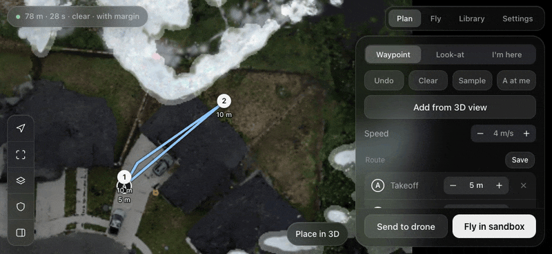
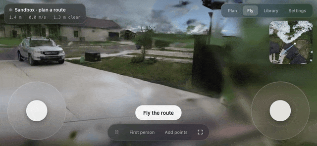
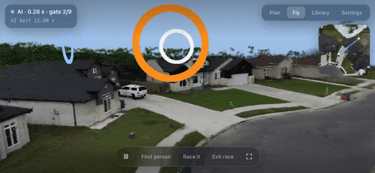

# DJI Flight Lab

Plan a route on a Gaussian-splat copy of your neighbourhood, fly it in a sandbox, then fly it for real on a DJI Mini 3, with a learned obstacle policy standing by and the RC sticks always able to take over.

This repo is the phone and web side. The simulator, training and pilot server are in [dji-rl](https://github.com/csaben/dji-rl).

| Plan | Fly and take over | Watch the AI race |
|---|---|---|
|  |  |  |

## What it does

**Plan**
- Tap the top-down splat map to drop waypoints, drag them, and set each one's height.
- Add look-at points with an activation range; the gimbal aims at them only when you're close.
- Place waypoints from the drone's first-person view in 3D, including "look here" with the gimbal tilt you see.
- Safe-height layer: the lowest altitude with 1.5 m clearance everywhere on the map, from the splat's collision field.
- FAA layer: the airspace class at the scene from the FAA's public UAS facility maps (controlled or not, LAANC ceiling, restricted areas). Point heights are capped at the legal ceiling for recreational flying.
- Route speed, loop back to A, and a live route check (length, time, clearance).

**Fly (sandbox)**
- The autopilot flies the route through the splat in first person or chase view.
- Grab either on-screen stick and you're flying. Let go, tap Re-arm and continue, and it rejoins the route from where you are.
- Leaving the live view hovers by default.

**Races**
- Drop ring gates in first person to make a course.
- Time trials with splits and your own ghost.
- Train the RL policy on a course from the Library, then race its ghost or watch its best lap from the drone's seat.

**Library**
- Saved routes, races and places, per splat.

**Real drone (Android app)**
- The same web UI runs inside the Flight Lab Android app. The drone's live video shows through behind it.
- Settings → Drone → Real drone switches the Fly screen to the Mini 3. Fly for real plans the route with a real-flight safety margin and loads it on the drone. It confirms (and asks about LAANC in controlled airspace), then takes off.
- The phone tracks the route with GPS and barometric altitude. Any RC stick movement latches control back to the pilot within about 50 ms. Failsafes: GPS, battery, corridor and altitude error.
- The obstacle pilot on the GPU box can run in shadow mode (beeps and logs what it would do) or live (flies the dodge, then hands back to the route).
- The app updates itself, and the web UI loads live, so most changes need no reinstall.

## How it fits together

```
 Android phone (Flight Lab)                 GPU box on the tailnet
 ┌───────────────────────────────┐         ┌──────────────────────────────────────┐
 │ WebView: sandbox.html (live)  │◄──https─┤ planner/server.py                    │
 │   window.FL bridge            │         │   static UI, missions, library,      │
 │ MissionRunner (25 Hz VS)      │         │   FAA lookup, /sim → simulator       │
 │ PilotLink (frames + telemetry)├──wss───►│ dji-rl: splat renderer, planner,     │
 │ DJI MSDK v5 ── RC-N1 ── Mini 3│◄─cmds───┤   race trainer, pilot policy         │
 └───────────────────────────────┘         └──────────────────────────────────────┘
```

| Path | What |
|---|---|
| `planner/static/sandbox.html` | The app UI: Plan, Fly, Library and Settings (single file, no build step) |
| `planner/server.py` | Serves the UI, stores missions, calibration and the library, proxies the simulator, FAA airspace lookup, APK downloads |
| `planner/static/index.html`, `plan.js`, `sim.js` | The original desktop planner |
| `android/flightlab/` | The Android side: `AppActivity` (WebView shell + JS bridge), `MissionRunner`, `PilotLink`, `FlightLabController` (virtual sticks, RC-override latch, logging), `Updater` |
| `android/sdk-sample.patch` | Our changes to DJI's MSDK v5 sample app, which hosts the package |
| `planner/tools/publish_apk.sh` | Build, then publish an app update (version.json + APK) |
| `docs/PLAN.md` | The original project plan |

## Building

The Android app builds inside DJI's [Mobile-SDK-Android-V5](https://github.com/dji-sdk/Mobile-SDK-Android-V5) sample (v5.20.1):

```bash
git clone https://github.com/dji-sdk/Mobile-SDK-Android-V5 && cd Mobile-SDK-Android-V5 && git checkout 2070246
git apply ../android/sdk-sample.patch
cp -r ../android/flightlab SampleCode-V5/android-sdk-v5-sample/src/main/java/dji/sampleV5/aircraft/
cp ../android/res/xml/* SampleCode-V5/android-sdk-v5-sample/src/main/res/xml/
cd .. && echo 'DJI_APP_KEY=your-key' > .env && ./build-sample.sh install
```

The DJI app key is bound to the package name `com.dji.sampleV5.aircraft` and stays in `.env`. Server addresses are tailnet hostnames in `AppActivity.kt`, `Updater.kt` and `PilotLink.kt`; change them to yours.

The planner is plain Python 3 with no dependencies: `python3 planner/server.py --port 8968`. It expects the dji-rl simulator on `127.0.0.1:8967`.

## Safety

This flies a real aircraft. The RC always wins: any stick input latches the autopilot off. Missions check GPS, satellite count, battery, corridor and altitude, and hold or hand back to the pilot when one fails. Fly within line of sight, follow your local rules (in the US: under 400 ft, LAANC in controlled airspace, TRUST certificate), and test with the axis check and shadow mode before letting anything fly itself.
